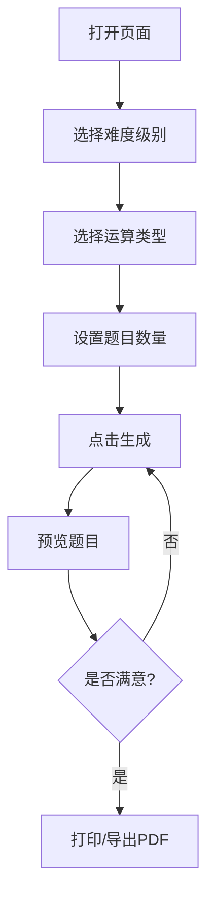

# 小学数学题目生成器

## 1. 产品概述

为小学低年级学生（1-3年级）设计的数学练习题批量生成工具，支持加减法题目的自定义生成与导出打印。

- 目标用户：小学低年级学生家长和教师
- 核心价值：快速生成排版规范、难度分级的数学练习题，节省手动出题时间

## 2. 核心功能

### 2.1 功能模块

1. **题目生成配置面板**：难度选择、运算类型、题目数量设置
2. **题目预览区域**：实时预览生成的题目排版效果
3. **打印/导出功能**：支持打印优化和PDF导出

### 2.2 页面详情

| 页面  | 模块   | 功能描述                                                           |
| --- | ---- | -------------------------------------------------------------- |
| 主页面 | 配置面板 | 难度级别选择（10以内/20以内/50以内/100以内）、运算类型选择（加法/减法/混合）、题目数量滑动条（10-100题） |
| 主页面 | 预览区域 | 双栏/三栏排版预览、题目编号、运算符号对齐、实时刷新                                     |
| 主页面 | 操作按钮 | 重新生成、打印、导出PDF                                                  |

## 3. 核心流程

用户打开页面 → 选择难度级别 → 选择运算类型 → 设置题目数量 → 点击生成 → 预览题目 → 打印或导出PDF

## 4. 用户界面设计

### 4.1 设计风格

- **主色调**：温暖柔和的米黄色背景(#FFF8E7) + 深棕色文字(#3D2914)，营造纸质作业本的感觉
- **强调色**：活泼的橙色(#FF8C42)用于按钮和重点元素，吸引儿童注意力
- **字体**：标题使用圆润可爱的"ZCOOL KuaiLe"字体，正文使用清晰易读的"Noto Sans SC"
- **布局**：左侧配置面板（固定宽度280px），右侧题目预览区域（自适应）
- **装饰元素**：手绘风格的边框、圆角卡片、淡淡的网格背景纹理

### 4.2 页面设计概述

| 页面  | 模块   | UI元素                  |
| --- | ---- | --------------------- |
| 主页面 | 配置面板 | 卡片式布局、单选按钮组、滑动条、彩色图标  |
| 主页面 | 预览区域 | 白色纸张背景、双栏排版、虚线分隔、题目编号 |
| 主页面 | 操作栏  | 大按钮设计、图标+文字、悬停动效      |

### 4.3 响应式设计

- 桌面端优先设计
- 平板端：配置面板变为顶部折叠区域
- 打印样式：隐藏配置面板，只显示题目区域，优化分页

### 4.4 动画效果

- 题目生成时的淡入动画（stagger效果，每行依次出现）
- 按钮悬停时的轻微缩放和阴影变化
- 配置项切换时的平滑过渡

